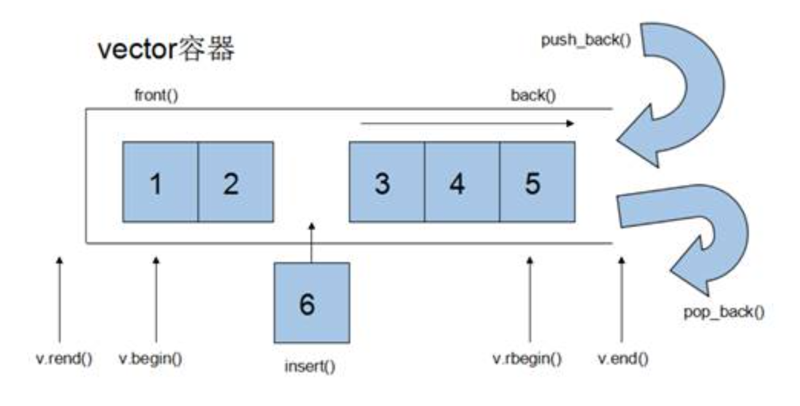

# vector
 - **功能**：单端数组，可以动态拓展
 - **拓展方式**：寻找更大的内存空间然后将原数据拷贝到新空间，释放原空间
 - **数据结构图**：

### vector构造函数
 - ==`vector<T> v;`==                                //采用模板类实现，默认构造函数
 - ==`vector(v.begin(),v.end());`==       //构造函数，将 \[ v.begin() , v.end() )区间中的元素拷贝给新变量
 - ==`vector(int n,T elem);`==               //构造函数，将n个elem拷贝给新变量
 - ==`vector(const vector &vec);`==      //拷贝构造函数
### vector赋值操作
 - ==`vector& operator=(const vector& vec);`== //重载等号操作符
 - ==`assign(begin,end);`==                                  //参数列表为迭代器，将\[begin , end)区间的数据拷贝给本身
 - ==`assign(int n,T elem);`==                            //将n个elem拷贝赋值给本身
### vector容量和大小
 - ==`bool empty();`==                                    //判断容器是否为空
 - ==`size_type size() const noexcept;`==   //返回容器中元素的个数
 - ==`size_type capacity() const noexcept;`==   //返回容器的容量
 - ==`void resize(int num);`==                     //重新指定容器长度为num，若容器变长，则以默认值重新填充新位置
 - ==`void resize(int num, T elem);`==      //重新指定容器长度为num，若容器变长，则以elem重新填充新位置，容器变短，则末尾超出部分元素被删除
### vector插入和删除
 - ==`push_back(T ele);`==                           //尾插元素ele
 - ==`pop_back();`==                                     //尾删元素
 - ==`insert(const_inerator pos,T ele)`== //迭代器指向位置pos处插入元素ele
 - ==`insert(const_iterator pos, int count ,ele);`== //迭代器指向位置pos处插入count个元素ele
 - ==`erase(const_iterator pos);`==            //删除迭代器指向的元素
 - //删除迭代器\[start, end）区间内的元素
   ==`erase(const_iterator start, const_iterator end);`==
 - ==`clear();`==                                          //删除容器中所有元素
### vector数据存取
 - ==`at(int idx);`==                                  //返回索引idx所指的数据
 - ==`operator;`==                    //返回索引idx所指的数据
 - ==`front();`==                                         //返回容器中第一个数据元素
 - ==`back();`==                                           //返回容器中最后一个数据元素
### vector互换容器
 - ==`swap(vector& vec);`==                        //将vec与本身的元素进行互换（底层原理是交换内部的指针所以很高效）
### vector预留空间
 - ==`reserve(int len);`==                         //容器预留len个元素长度，预留位置不初始化，元素不可访问，减少动态扩容的次数