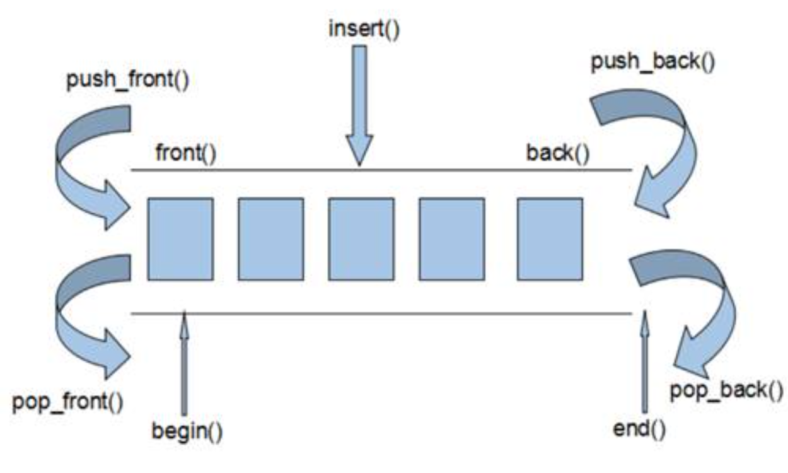
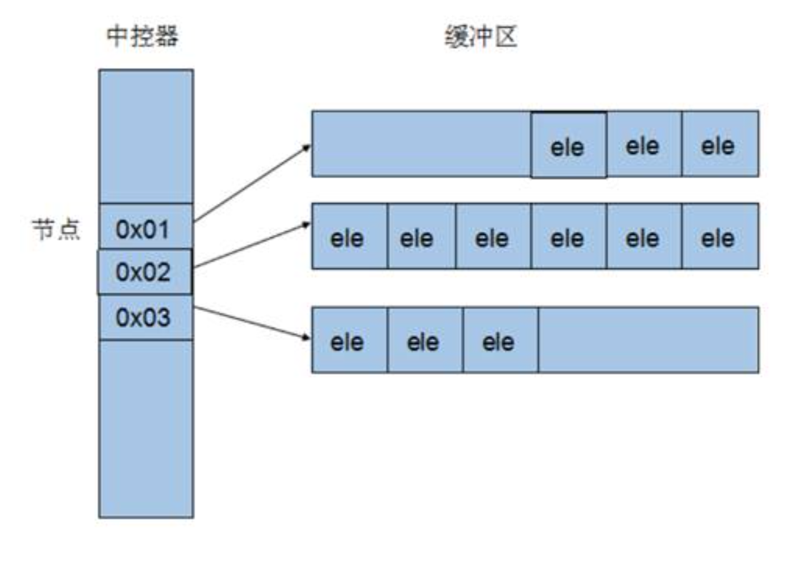

# deque
 - **功能**：双端数组，可以对头端进行插入删除操作，无容量概念
 - **与vector的区别**：
	1. vector对于头部的插入删除效率低，数据量大
	2. deque相对来说，对头部的删除速度比vector快
	3. vector访问元素的速度比deque快
 - **逻辑效果图**
- 
 - **数据结构图**：
- 
### deque构造函数
 - ==`deque<T> deq`==                                          //默认构造函数
 - ==`deque(begin,end);`==                                 //构造函数将\[begin,end)区间中的元素拷贝给本身
 - ==`deque(n，elem);`==                                     //构造函数将n个elem拷贝给本身
 - ==`deque(const deque &deq);`==                     //拷贝构造函数
### deque赋值操作
 - ==`deque& operator=(const deque &deq);`== //重载等号操作符
 - ==`assign(beg,end);`==                                  //将\[beg,end)区间中的数据拷贝赋值给本身
 - ==`assign(n，elem);`==                                  //将n个elem拷贝赋值给本身
### deque大小
 - ==`empty();`==                                              //判断容器是否为空
 - ==`size();`==                                               //返回容器中元素的个数
 - ==`resize(int num);`==                       //重新指定容器长度为num，若容器变长，则以默认值重新填充新位置
 - ==`resize(int num, T elem);`==         //重新指定容器长度为num，若容器变长，则以elem重新填充新位置，容器变短，则末尾超出部分元素被删除
### deque插入和删除
 - ==`push_back(T ele);`==                            //尾插元素ele
 - ==`pop_back();`==                                      //尾删元素
 - ==`push_front(T ele);`==                          //头插元素ele
 - ==`pop_front();`==                                    //头删元素
 - //迭代器指向位置pos处插入元素ele
   ==`insert(const_iterator pos,T ele);`== 
 - //迭代器指向位置pos处插入count个元素ele
   ==`insert(const_iterator pos, int count ,ele);`== 
 - //迭代器指向位置pos处插入\[beg,end)区间的数据
   ==`insert(const_iterator pos, begin ,end);`== 
 - //删除迭代器指向的元素
   ==`erase(const_iterator pos);`==            
 - //删除迭代器\[start, end）区间内的元素
   ==`erase(const_iterator start, const_iterator end);`==
 - ==`clear();`==                                          //删除容器中所有元素
### deque数据存取
 - ==`at(int idx);`==                                  //返回索引idx所指的数据
 - ==`operator;`==                    //返回索引idx所指的数据
 - ==`front();`==                                         //返回容器中第一个数据元素
 - ==`back();`==                                           //返回容器中最后一个数据元素