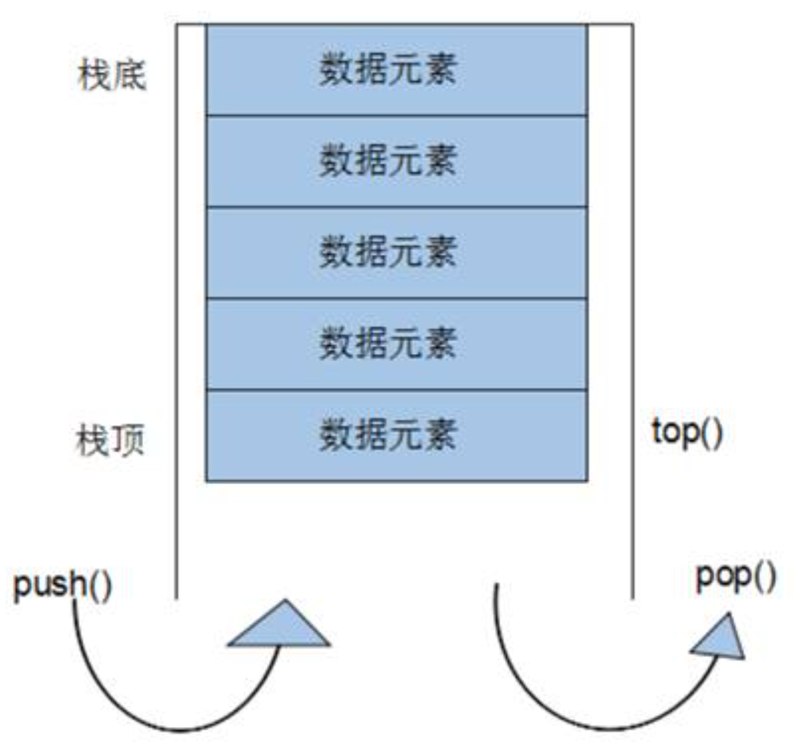
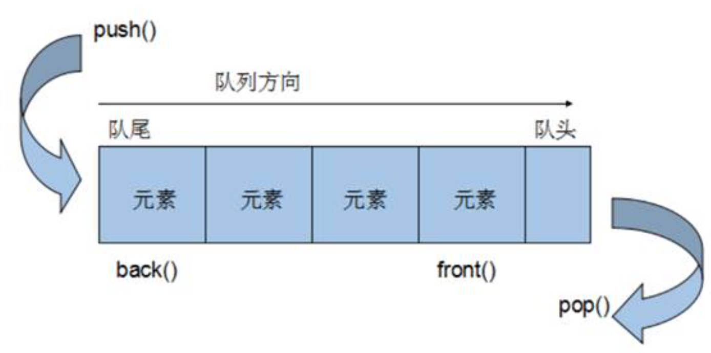

# stack
 - **概念**：栈容器，后进先出的数据结构，只有顶部的元素才能被外界使用，不允许有遍历行为
 - **数据结构图**：
- 
### stack构造函数
 - ==`stack<T> stk;`==                                        //模板类实现，默认构造函数
 - ==`stack(const stack& stk);`==                     //拷贝构造函数
### stack赋值操作
 - ==`stack& operator=(const stack& stk);`==  //重载等号操作符
### stack数据存取
 - ==`push(elem);`==                                            //向栈顶添加数据，压入栈顶-入栈
 - ==`pop();`==                                                     //从栈顶移除第一个元素，弹出栈顶元素-出栈
 - ==`top();`==                                                     //获取栈顶元素
### stack大小操作          
 - ==`empty();`==                                                 //判断栈是否为空
 - ==`size();`==                                                   //返回栈的大小

# queue
 - **概念**：队列容器，先进先出的数据结构，不允许有遍历行为
 - **数据结构图**：
- 
### queue构造函数
 - ==`queue<T> que;`==                                         //queue模板类实现，默认构造函数
 - ==`queue(const queue& que);`==                      //拷贝构造函数
### queue赋值操作
 - ==`queue& operator=(const queue& que);`==   //重载构造函数
### queue数据存取
 - ==`push(elem);`==                                            //向队尾添加元素-入队
 - ==`pop();`==                                                     //从队头移除一个元素-出队
 - ==`back();`==                                                   //获取队尾元素
 - ==`front();`==                                                 //获取队头元素
### queue大小操作
 - ==`empty();`==                                                 //判断队列是否为空
 - ==`size();`==                                                   //返回队列的大小