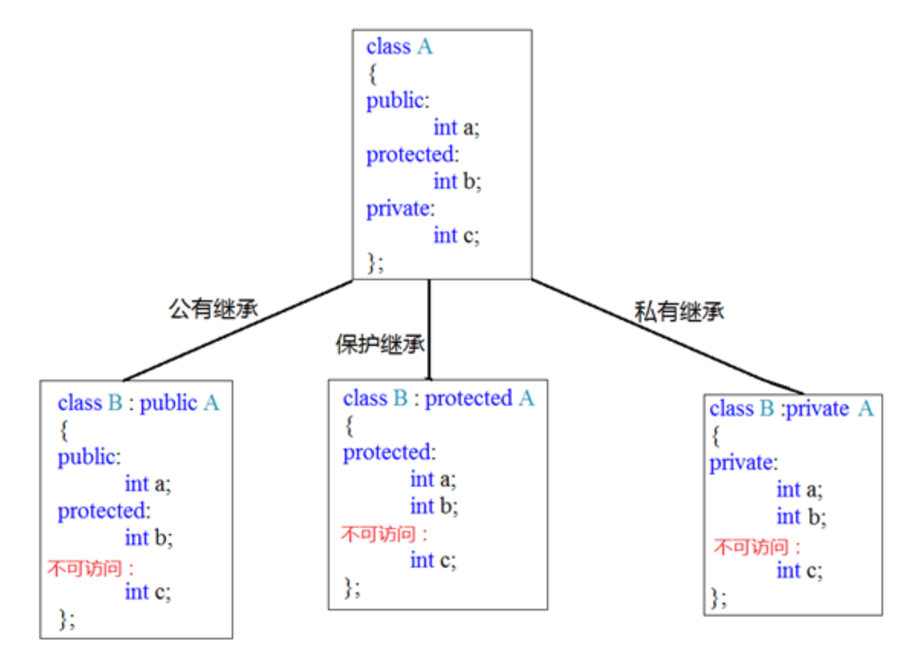

# 继承
 - **语法**：==class 子类 ：继承方式 父类 {}==
 - **继承方式**：
	1. **公共继承**：==class B : public A== （public部分继承为public 、protected部分继承为protected 、private部分不可访问）
	2. **保护继承**：==class B : protected A== （public 、protected部分继承为protected 、private部分不可访问）
	3. **私有继承**：==class B : private A==（public 、protected部分继承为private 、private部分不可访问）
	
 - **作用**：减少重复代码，子类(派生类)在基类(父类)继承的基础上添加个性
 - **注意**:父类中私有成员也是被子类继承下去了，只是由编译器给隐藏后访问不到
 - **构造顺序**：继承中先调用父类构造函数，再调用子类构造函数，析构顺序与构造相反
 - **继承同名成员处理方式**：
	1. 子类对象可以直接访问到子类中同名成员
	2. 子类对象加作用域可以访问到父类同名成员
	3. 当子类与父类拥有同名的成员函数，子类会隐藏父类中同名成员函数，加作用域可以访问到父类中同名函数
 示例一：
```C++
 class Base {
public:
	Base()
	{
		m_A = 100;
	}

	void func()
	{
		cout << "Base - func()调用" << endl;
	}

	void func(int a)
	{
		cout << "Base - func(int a)调用" << endl;
	}

public:
	int m_A;
};


class Son : public Base {
public:
	Son()
	{
		m_A = 200;
	}

	//当子类与父类拥有同名的成员函数，子类会隐藏父类中所有版本的同名成员函数
	//如果想访问父类中被隐藏的同名成员函数，需要加父类的作用域
	void func()
	{
		cout << "Son - func()调用" << endl;
	}
public:
	int m_A;
};

void test01()
{
	Son s;

	cout << "Son下的m_A = " << s.m_A << endl;
	cout << "Base下的m_A = " << s.Base::m_A << endl;

	s.func();
	s.Base::func();
	s.Base::func(10);

}
int main() {

	test01();

	system("pause");
	return 0;
}
```
示例二：静态同名成员
```C++
class Base {
public:
	static void func()
	{
		cout << "Base - static void func()" << endl;
	}
	static void func(int a)
	{
		cout << "Base - static void func(int a)" << endl;
	}

	static int m_A;
};

int Base::m_A = 100;

class Son : public Base {
public:
	static void func()
	{
		cout << "Son - static void func()" << endl;
	}
	static int m_A;
};

int Son::m_A = 200;

//同名成员属性
void test01()
{
	//通过对象访问
	cout << "通过对象访问： " << endl;
	Son s;
	cout << "Son  下 m_A = " << s.m_A << endl;
	cout << "Base 下 m_A = " << s.Base::m_A << endl;

	//通过类名访问
	cout << "通过类名访问： " << endl;
	cout << "Son  下 m_A = " << Son::m_A << endl;
	cout << "Base 下 m_A = " << Son::Base::m_A << endl;
}

//同名成员函数
void test02()
{
	//通过对象访问
	cout << "通过对象访问： " << endl;
	Son s;
	s.func();
	s.Base::func();

	cout << "通过类名访问： " << endl;
	Son::func();
	Son::Base::func();
	//出现同名，子类会隐藏掉父类中所有同名成员函数，需要加作作用域访问
	Son::Base::func(100);
}
int main() {

	//test01();
	test02();

	system("pause");

	return 0;
}
``` 
(同名静态成员处理方式和非静态处理方式一样，只不过有两种访问的方式(通过对象和通过类名))

 - **多继承**
	 - **语法**：==class 子类 : 继承方式 父类1 , 继承方式 父类2 ...==
	 - **注意**：多继承中如果父类中出现了同名情况，子类使用时候要加作用域
 - **虚继承**：
	 - **语法**：====class 子类 : virtual 继承方式 父类 ==
	 - **作用**：消除冗余内存，解决访问二义性，保持数据访问一致性，解决菱形继承问题
```C++
class Animal
{
public:
	int m_Age;
};

//继承前加virtual关键字后，变为虚继承
//此时公共的父类Animal称为虚基类
class Sheep : virtual public Animal {};
class Tuo   : virtual public Animal {};
class SheepTuo : public Sheep, public Tuo {};

void test01()
{
	SheepTuo st;
	st.Sheep::m_Age = 100;
	st.Tuo::m_Age = 200;

	cout << "st.Sheep::m_Age = " << st.Sheep::m_Age << endl;
	cout << "st.Tuo::m_Age = " <<  st.Tuo::m_Age << endl;
	cout << "st.m_Age = " << st.m_Age << endl;
}


int main() {

	test01();

	system("pause");

	return 0;
}
```
