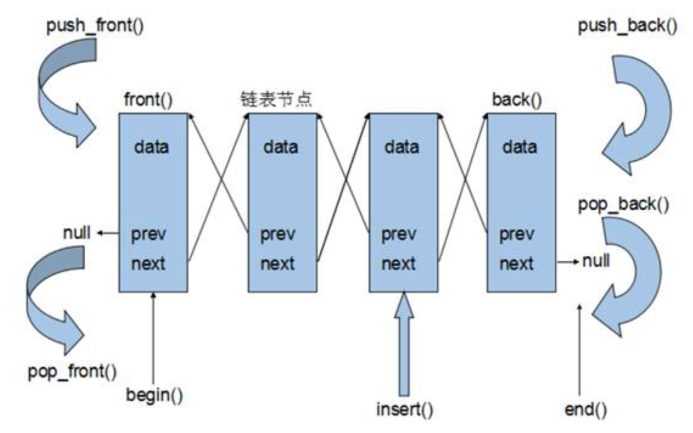

# list
 - **概念**：链表，物理存储单元上非连续的存储的结构，数据元素的逻辑顺序是通过链表中的指针链接实现的，STL中是双向链表，主流实现为双向循环链表
 - **组成**：链表由结点组成，结点由储存数据元素的数据域和储存下一个结点地址的指针域组成
 - **优点**：
	1. 采用动态存储分配，不会造成内存浪费和溢出
	2. 链表的插入和删除很方便，只用修改指针，不用移动大量元素
	3. 插入和删除不会造成原本迭代器失效
 - **缺点**：
	1. 空间占用（指针域）和时间（遍历）的额外消耗较大
	2. 迭代器为双向迭代器，只能前移和后移
 - **list数据结构图(双向链表)**：

### list构造函数
 - ==`list<T> lst;`==                                             //模板类实现，默认构造函数
 - ==`list(beg,end);`==                                         //构造函数将\[beg, end)区间中的元素拷贝给本身
 - ==`list(n,elem);`==                                           //构造函数将n个elem拷贝给本身
 - ==`list(const list& lst);`==                           //拷贝构造函数
### list赋值和交换
 - ==`assign(beg, end);`==                                    //构造函数将\[beg, end)区间中的元素拷贝给本身
 - ==`assign(n, elem);`==                                      //构造函数将n个elem拷贝给本身
 - ==`list& operator=(const list& lst);`==        //重载等号操作符
 - ==`swap(lst);`==                                                //将lst与本身的元素互换
### list大小操作
 - ==`size();`==                                                      //返回容器中元素的个数
 - ==`empty();`==                                                    //判断容器是否为空
 - ==`resize(num);`==                                             //重新指定容器长度为num，若容器变长，则以默认值重新填充新位置
 - ==`resize(num,elem);`==                                    //重新指定容器长度为num，若容器变长，则以elem重新填充新位置，容器变短，则末尾超出部分元素被删除
### list插入和删除
 - ==`push_back(elem);`==                                      //在容器尾部加入一个元素
 - ==`pop_back();`==                                               //删除容器最后一个元素
 - ==`push_front(elem);`==                                    //在容器开头插入一个元素
 - ==`pop_front();`==                                            //删除容器开头一个元素
 - ==`insert(pos,elem);`==                                   //在pos位置插elem元素的拷贝，返回新数据的位置
 - ==`insert(pos,n,elem);`==                                //在pos位置插入n个elem数据，无返回值
 - ==`insert(pos,beg,end);`==                              //在pos位置插入\[beg,end)区间的数据，无返回值
 - ==`clear();`==                                                   //移除容器的所有数据
 - ==`erase(beg,end);`==                                       //删除\[beg,end)区间的数据，返回下一个数据的位置
 - ==`erase(pos);`==                                              //删除pos位置的数据，返回下一个数据的位置
 - ==`remove(elem);`==                                          //删除容器中所有与elem值匹配的元素
### list数据存取
 - ==`front();`==                                                  //返回第一个元素
 - ==`back();`==                                                    //返回最后一个元素
### list反转和排序
 - ==`reverse();`==                                              //反转链表
 - ==`sort(myCompare);`==                                    //排序链表，myCompare为谓词用于自定义排序方式，不填则默认为从小到大

示例：排序案例
```C++
#include <list>
#include <string>
class Person {
public:
	Person(string name, int age , int height) {
		m_Name = name;
		m_Age = age;
		m_Height = height;
	}

public:
	string m_Name;  //姓名
	int m_Age;      //年龄
	int m_Height;   //身高
};


bool ComparePerson(Person& p1, Person& p2) {

	if (p1.m_Age == p2.m_Age) {
		return p1.m_Height  > p2.m_Height;
	}
	else
	{
		return  p1.m_Age < p2.m_Age;
	}

}

void test01() {

	list<Person> L;

	Person p1("刘备", 35 , 175);
	Person p2("曹操", 45 , 180);
	Person p3("孙权", 40 , 170);
	Person p4("赵云", 25 , 190);
	Person p5("张飞", 35 , 160);
	Person p6("关羽", 35 , 200);

	L.push_back(p1);
	L.push_back(p2);
	L.push_back(p3);
	L.push_back(p4);
	L.push_back(p5);
	L.push_back(p6);

	for (list<Person>::iterator it = L.begin(); it != L.end(); it++) {
		cout << "姓名： " << it->m_Name << " 年龄： " << it->m_Age 
              << " 身高： " << it->m_Height << endl;
	}

	cout << "---------------------------------" << endl;
	L.sort(ComparePerson); //排序

	for (list<Person>::iterator it = L.begin(); it != L.end(); it++) {
		cout << "姓名： " << it->m_Name << " 年龄： " << it->m_Age 
              << " 身高： " << it->m_Height << endl;
	}
}

int main() {

	test01();

	system("pause");

	return 0;
}
```
 