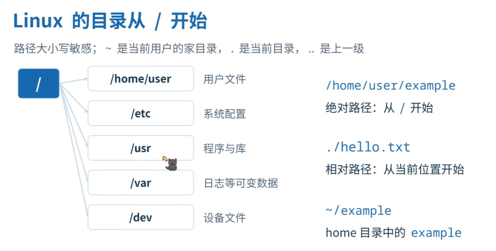
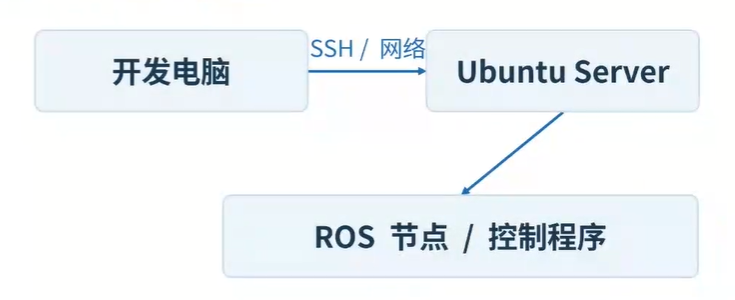
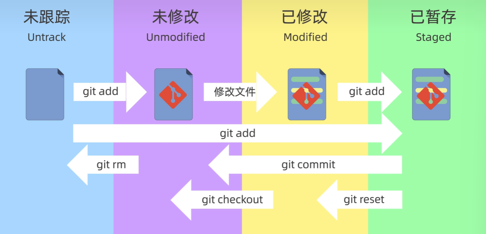
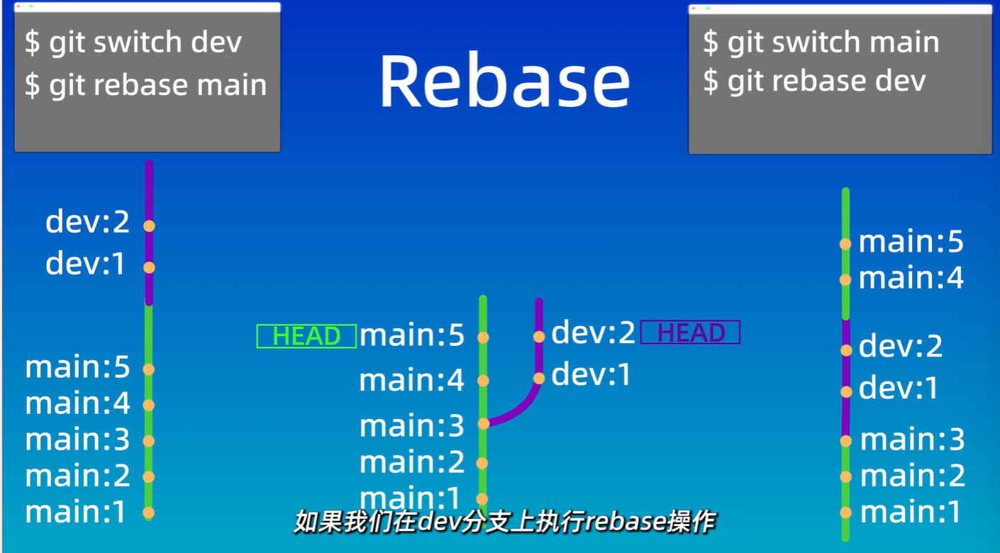
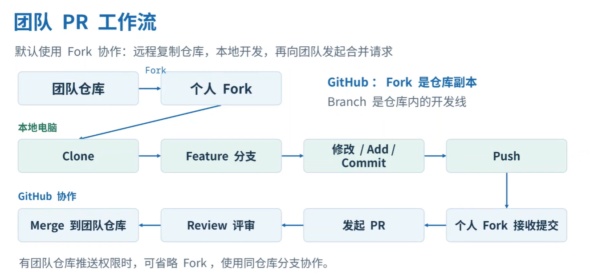

# Linux 基础
- **目录与路径**：
- **机器人开发流程**：
# Shell

### 一、基本概念
**Shell**：命令解释器

**脚本规范**
```Bash
#!/bin/bash
# 首行的#指定解释器
# 第二行开始的#为注释

# 严格模式：
# -e（命令返回非零退出码时直接退出）
# -u（引用未定义变量退出）
# -o pipefail（管道中任意一个命令失败，整个管道退出码非零）
set -euo pipefail 
```

**执行方式**
```Bash
bash test.sh      # 使用bash执行

chmod +x test.sh  #赋予执行权限
./test.sh         # 需要先赋予执行权限

source test.sh    # 在当前Shell执行 ，变量会保留
. test.sh         # 等价于source test.sh
#区别理解：source执行相当与在当前shell中输入这几行命令 
#        使用另外两个相当与新开一个命令行执行命令（子进程）不影响父进程
```
### 二、变量

**变量的定义与使用**
```Bash
name="人类"      # 变量赋值=两边不能有空格   
$name           # $获取变量的值
${name}         # $获取变量的值，推荐加{}明确边界
readonly name   # 设置只读不能被取消，删除，修改
unset name      # 删除变量
export name     # 设置为环境变量，可以被子进程读取
local name      # 局部变量，可以限制在函数里生效
```

**特殊变量**
```Bash
$0              # 脚本名
$1~$9、${10}    # 位置参数，脚本运行时传入的参数
$#              # 参数个数
$@              # 所有参数（各自独立）
$*              # 所有参数（单个字符串）
$?              # 上条命令退出码（0 成功）
$$              # 当前进程的PID（进程编号）
$!              # 后台最后进程的PID
```
### 三、字符串与数组

**字符串**
```Bash
str="hello world"
${#str}              # 字符串的长度
${str:n:m}           # 字符串截取n~m的部分的子串
${str/$str1/$str2}   # 字符串中将第一个str1换成str2
${str//$str1/$str2}  # 字符串中将全部的str1换成str2

[ -z "$str" ]        # 判断str为空
[ -n "$str" ]        # 判断str非空
[ "$str1" = "$str2" ]# 判断str1与str2相等
```

**数组**
```Bash
arr=(a b c d)
${arr[i]}         # 第i个元素
${arr[@]}         # 全部元素
${#arr[@]}        # 数组长度
${arr[@]:n:m}     # 截取第n~m个数组
```

### 四、运算符与操作符

**算术运算符**
```Bash
a=1
b=2
((a+b))   # (( ))执行计算并判断真假
$((a+b))  # $(())获取计算结果
let "a+=2"  # let和（（ ））基本一样,可以用""把表达式括起来当成一个整体，如果表达式有空格且没加""会被当成独立的东西
# 运算符在（（ ））中和C语言一样
```

**数值比较**
```Bash
-eq      # 等于
-gt      # 大于
-ge      # 大于等于
-ne      # 不等
-lt      # 小于
-le      # 小于等于
```

**文件**
```Bash
#测试文件状态的操作符
-e       # 判断存在
-d       # 判断是否为目录
-f       # 判断是否为普通文件
-s       # 判断是否非空
-r       # 读权限
-w       # 写权限
-x       # 执行执行权限
```

**逻辑运算**
```Bash
[ $a -gt 5 ] && echo "big"    # 与
[ $a -gt 5 ] || echo "small"  # 或
[ ! -f file ]                 # 非
```

**括号**
```Bash
[ ]      # 测试，条件判断，当前进程执行[]里的命令
[[ ]]    # 增强版[]可以在里面使用&& || 等逻辑运算符
( )      # 启动一个子进程执行()里的命令，返回最后一条命令的状态码
(( ))    # 算术命令不用$就能计算，返回真假、0为假
$(( ))   # 和(())一样，返回计算后的数值
```
### 五、流程控制

**if**
```Bash
if [ "$a" -gt 10 ]; then
    echo "大于10"
elif [ "$a" -eq 10 ]; then
    echo "等于10"
else
    echo "小于10"
fi
```

**case**
```Bash
case "$1" in                                       # 判断$1是否与下面相等
    start)   echo "starting..." ;;                 # $1 == start
    stop|halt) echo "stopping..." ;;               # $1 == stop 或 $1 == halt
    *)       echo "usage: $0 {start|stop}" ;;      # *是通配符
esac
```

**for**
```Bash
for i in 1 2 3; do       # 循环头：in 后面跟着一个列表，用空格隔开, ;相当与换行
	# 循环内容            # 取i分别为列表的值
done                     # 循环结束标志

for ((i=0; i<5; i++)); do
	# 循环内容
done

for i in {1..5}; do      # {}展开1~5
	# 循环内容 
done    # 打印 1 到 5

#特殊用法
for file in *.txt; do         # file遍历当前目录下的.txt文件
    # 循环内容
done

for i in "$@"; do             # i遍历所有参数
    # 循环内容
done
```

**while与until**
```Bash
while [ 条件 ]; do             # 当条件为真时进行循环
	 # 循环内容
done

until [ 条件 ]; do             # 当条件为假时进行循环
    # 循环内容
done
```

**关键字**
```Bash
break        # 退出,break n 可以指定跳出n层循环
continue     # 跳过本次，进行下一次循环
```

**条件连接**
```Bash
例如：mkdirdemo&& cddemo-p  # 前一条成功后，再执行下一条
```
### 六、函数

```Bash
hello(){
	local name=$1
	echo "你好，$name"
}
hello "人类"

getadd(){
	echo $(($1+$2))
	echo $(($2-$1))
}
result=$(getadd 2 3)         # 打印的值会存储到变量里

```

### 七、输入输出与重定向

**标准输入输出流**

| 名称     | 文件描述符 | 默认设备 | 作用             |
| ------ | ----- | ---- | -------------- |
| stdin  | 0     | 键盘   | 程序读取数据的位置      |
| stdout | 1     | 终端   | 程序正常运行的结果输出的位置 |
| stderr | 2     | 终端   | 程序报错信息输出的位置    |

**输出重定向**：改变数据流向，把本该输出到屏幕的内容，写到文件里
```Bash
# > 覆盖写入、清空原文件，写入新内容
echo "Hello" > test.txt      # test.txt 现在只有 "Hello"
echo "World" > test.txt      # test.txt 被清空，变成 "World"
# >> 追加写入、保留原文件，在末尾添加
echo "Hello" >> test.txt
echo "World" >> test.txt     # test.txt 里面是hello （换行）world
# （> 和 >> 默认等同于 1> 和 1>>）

# 2> 覆盖写入错误日志
ls /nonexistent_dir 2> error.log 
# 2>> 追加写入错误日志
ls /nonexistent_dir 2> error.log

# &> 、&>> stdout 和 stderr 都重定向到文件

# 丢弃输出，> /dev/null
```

**输入重定向**
```Bash
# < 从文件读取读入
# 本来 grep 需要键盘输入，现在直接从 file.txt 读
grep "error" < file.txt

# <<< 把一个字符串直接输入
grep "root" <<< "user=root"   

# << 在脚本里直接嵌入多行文本作为输入
cat << EOF > config.conf 
host=localhost
port=3306
user=root
EOF
```

**管道**
```Bash
# 把前一个命令的输出直接变成后一个命令的输入
ls -l | grep ".txt" | awk '{print $9}'
```

**echo与printf**
```Bash
echo "Hello"           # 输出
echo -n "Loading..."   # 不换行输出
echo -e "a\tb\nc"      # 启用转义字符
echo 'Hello $name'     # 单引号原样输出
echo "Hello $name"     # 双引号解析变量
echo "x" > file.txt    # 写文件

printf "姓名: %s\n年龄: %d\n" "Tom" 25   # 可移植性更好
```

### 八、Linux常用命令

```Bash
ls                  # 列出目录内容 (ls -lh 详细人类可读, ls -a 显示隐藏)
cd                  # 切换目录 (cd .. 返回上级, cd - 返回上次目录)
pwd                 # 显示当前所在路径
mkdir               # 创建目录 (mkdir -p 递归创建多级)
rm                  # 删除文件或目录
cp                  # 复制文件或目录
touch               # 创建空文件或更新时间戳
find                # 搜索文件
mv                  # 移动文件或重命名

cat                 # 一次性查看整个文件内容
batcat              # 带语法高亮的cat
less / more         # 分页查看大文件
head / tail         # 查看文件头/尾
grep                # 文本搜索 (grep -i 忽略大小写, grep -v 反向过滤)
awk                 # 按列提取文本
wc                  # 统计 (wc -l 统计行数、wc -c 统计字节数 wc -w 统计单词数)
sort                # 排序
uniq                # 去重
echo                # 打印输出文本
diff                # 比较两个文件的差异

ps                  # 查看进程
top                 # 实时监控系统资源与进程状态
kill                # 终止进程
df                  # 查看磁盘空间使用情况
date                # 显示或设置日期时间
history             # 查看历史命令
crontab             # 定时任务管理

ping                # 测试网络连通性 (ping -c 限制次数)
curl                # 发送 HTTP 请求
scp                 # 跨机器复制文件
ss                  # 查看网络端口占用

chmod               # 修改文件权限 (chmod +x script.sh 加执行权限)
chown               # 修改文件所有者 
sudo                # 以管理员执行命令

--help              #查询命令的参数和作用
```

# Vim

**打开**： `vim 文件`

**四大模式**：

| 模式   | 功能        | 方式  |
| ---- | --------- | --- |
| 正常模式 | 移动、删除、复制  | Esc |
| 编辑模式 | 输入文本，编辑文本 | i   |
| 命令模式 | 保存、退出、替换  | v   |
| 可视模式 | 选中文本      | :   |


**常用命令和快捷键**：
（感觉常用的就记了，先记这么多）

| 快捷键     | 功能          |
| ------- | ----------- |
| i       | 光标前插入       |
| a       | 光标后插入       |
| I       | 行首插入        |
| A       | 行尾插入        |
| o       | 下方新开一行      |
| O       | 上方新开一行      |
| s       | 删除当前字符并插入   |
| S       | 删除整行并插入     |
| h j k l | 左 下 上 右     |
| w       | 下一个单词开头     |
| gg      | 文件开头        |
| G       | 文件末尾        |
| :n      | 跳转到第n行      |
| /word   | 向下搜索        |
| ?word   | 向上搜索        |
| x       | 删除当前字符      |
| dd      | 删除整行        |
| dw      | 删除单词        |
| ndd     | 删除n行        |
| yy      | 复制整行        |
| yw      | 复制单词        |
| u       | 撤销操作        |
| Ctrl+r  | 重做          |
| .       | 重复上一次操作     |
| v       | 进入可视模式，字符选中 |
| V       | 行选择         |
| Ctrl+v  | 列选中         |
| y       | 复制选中        |
| p       | 粘贴          |
| :w      | 保存          |
| :q      | 退出          |
| :wq     | 保存并退出       |
| :q!     | 退出不保存       |

# Git&Github
### 一、简单配置
（必须配置不然会报错）
```Bash
git config --global user.name "你的名字"
git config --global user.email "你的邮箱"
```
### 二、Git区域


### 三、常用命令
```Bash
git init             # git仓库初始化
git clone 仓库地址    # 从远程服务器上克隆仓库

git add 文件          # 添加文件到暂存区
git commit -m "说明"  # 将暂存区文件提交到本地仓库
git push             # 将本地仓库推送到远程仓库

git status           # 查看状态
git log              # 查看提交记录(--oneline简短格式)
git reflog           # 记录本地仓库指针的每一次移动,可以查看被删除、回退的记录
git diff             # 比较差异）(默认(工作区和暂存区) HEAD(工作区和版本库) --cached(暂存区和版本库)  版本id1 版本id2(两个版本的差别))
git ls-files         # 查看暂存区的文件
git reset 参数 提交id #回退到某一版本(--soft、--hard、--mixed) 

git rm --cached 文件  # 将文件从暂存区删除，不跟踪文件，不加--cached会删除工作区和暂存区的文件
```

### 四、.gitignore
- **功能**：忽略文件不提交到git仓库
- **注意**：如果文件已经被添加需要先用git rm移除不然还会跟踪
- **匹配规则**：
	1. 从上到下逐行匹配，每一行表示一个忽略模式
	2. 空行或者以#开头的行会被Git忽略。一般空行用于可读性的分隔，#一般用作注释
	3. 使用标准的glob模式匹配，例如:
		- 星号\*通配任意个字符
		- 问号?匹配单个字符
		- 中括号\[]表示匹配列表中的单个字符，比如:\[abc]表示a/b/c
	4. 两个星号\*\*表示匹配任意的中间目录
	5. 中括号可以使用短中线连接，比如:
		- \[0-9]表示任意一位数字
		- \[a-z]表示任意一位小写字母
	6. 感叹号!表示取反
### 五、GitHub远程仓库
- **SSH配置密钥**：
	1. 生成公钥和私钥`ssh-keygen -t ed25519 -C "邮箱"`
		- 私钥文件`id_rsa`、公钥文件`id_rsa.pub`、
	2. 复制公钥
	3. 粘贴到github：Settings -> SSH and GPG keys -> 点击 New SSH key -> 把刚才复制的内容粘贴进去并保存
- **远程与本地同步**：
	- **克隆仓库**：`git clone <repo-address>`
	- **推送更新内容**：`git push <remote> <branch>`(-u 长期绑定)
	- **拉取更新内容**：`git pull <remote> <分支名_远程>:<分支名_本地>`
	- **查看远程仓库**：`git remote -v`
### 六、分支
- **分支命令**：
```Bash
git branch                # 查看当前仓库所有分支
git branch <分支名>        # 创建新的分支
git checkout <分支名>      # 切换分支(也有恢复文件的作用可能产生歧义)
git switch <分支名>        # 切换分支
git merge <将被合并的分支>  # 合并分支(当前所在的分支为目标分支)

git log --graph --oneline --decorate --all
# 查看分支图

git branch -d <分支名>     # 删除分支(如果分支未合并则需要使用-D)
```
- **合并冲突**：
	两个分支修改了同一个文件的同一处位置会产生合并冲突
	- **解决办法**：
		1. 手动修改冲突文件，合并冲突内容
		2. 添加暂存区
		3. 提交修改
	- **中止合并**：git merge --abort

- **git rebase**：

	**rebase和merge对比**：
		**merge**：
			- 优点：不会破坏原分支的提交历史，方便回溯和查看
			- 缺点：会产生额外的提交节点，分支图比较复杂
		**rebase**：
			- 优点：不会新增额外的提交记录，形成线性历史，比较直观和干净
			- 缺点：会改变提交历史，改变了当前分支branch out的节点，避免在共享分支使用
### 七、DX PR要求
- **PR工作流**：
- PR提交后不可关闭再提交，在原来PR上修改
- PR标题要求：英文、开头大写、英文句号`.`结尾
# 更多笔记链接
Cpp和其他在准备DX面试过程中的学习笔记仓库链接：[xpj2007/study_notes](https://github.com/xpj2007/study_notes)

