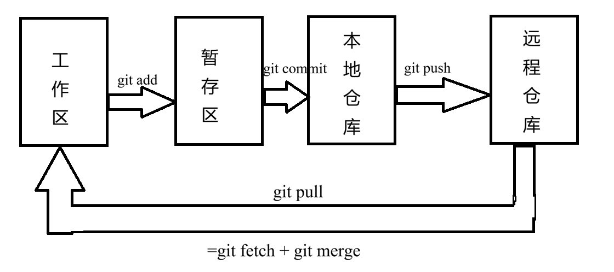

# 一、简单配置
（必须配置不然会报错）
```Bash
git config --global user.name "你的名字"
git config --global user.email "你的邮箱"
```
# 二、Git区域


# 三、常用命令
```Bash
git init             # git仓库初始化
git clone 仓库地址    # 从远程服务器上克隆仓库

git add 文件          # 添加文件到暂存区
git commit -m "说明"  # 将暂存区文件提交到本地仓库
git push             # 将本地仓库推送到远程仓库

git status           # 查看状态
git log              # 查看提交记录(--oneline简短格式)
git reflog           # 记录本地仓库指针的每一次移动,可以查看被删除、回退的记录
git diff             # 比较差异）(默认(工作区和暂存区) HEAD(工作区和版本库) --cached(暂存区和版本库)  版本id1 版本id2(两个版本的差别))
git ls-files         # 查看暂存区的文件
git reset 参数 提交id #回退到某一版本(--soft、--hard、--mixed) 

git rm --cached 文件  # 将文件从暂存区删除，不跟踪文件，不加--cached会删除工作区和暂存区的文件
```

# 四、.gitignore
- **功能**：忽略文件不提交到git仓库
- **注意**：如果文件已经被添加需要先用git rm移除不然还会跟踪
- **匹配规则**：
	1. 从上到下逐行匹配，每一行表示一个忽略模式
	2. 空行或者以#开头的行会被Git忽略。一般空行用于可读性的分隔，#一般用作注释
	3. 使用标准的glob模式匹配，例如:
		- 星号\*通配任意个字符
		- 问号?匹配单个字符
		- 中括号\[]表示匹配列表中的单个字符，比如:\[abc]表示a/b/c
	4. 两个星号\*\*表示匹配任意的中间目录
	5. 中括号可以使用短中线连接，比如:
		- \[0-9]表示任意一位数字
		- \[a-z]表示任意一位小写字母
	6. 感叹号!表示取反
# 五、GitHub远程仓库
- **SSH配置密钥**：
	1. 生成公钥和私钥`ssh-keygen -t ed25519 -C "邮箱"`
		- 私钥文件`id_rsa`、公钥文件`id_rsa.pub`、
	2. 复制公钥
	3. 粘贴到github：Settings -> SSH and GPG keys -> 点击 New SSH key -> 把刚才复制的内容粘贴进去并保存
- **远程与本地同步**：
	- **克隆仓库**：`git clone <repo-address>`
	- **推送更新内容**：`git push <remote> <branch>`(-u 长期绑定)
	- **拉取更新内容**：`git pull <remote> <分支名_远程>:<分支名_本地>`
	- **查看远程仓库**：`git remote -v`
# 六、分支
- **分支命令**：
```Bash
git branch                # 查看当前仓库所有分支
git branch <分支名>        # 创建新的分支
git checkout <分支名>      # 切换分支(也有恢复文件的作用可能产生歧义)
git switch <分支名>        # 切换分支
git merge <将被合并的分支>  # 合并分支(当前所在的分支为目标分支)

git log --graph --oneline --decorate --all
# 查看分支图

git branch -d <分支名>     # 删除分支(如果分支未合并则需要使用-D)
```
- **合并冲突**：
	两个分支修改了同一个文件的同一处位置会产生合并冲突
	- **解决办法**：
		1. 手动修改冲突文件，合并冲突内容
		2. 添加暂存区
		3. 提交修改
	- **中止合并**：git merge --abort

- **git rebase**：

	**rebase和merge对比**：
		**merge**：
			- 优点：不会破坏原分支的提交历史，方便回溯和查看
			- 缺点：会产生额外的提交节点，分支图比较复杂
		**rebase**：
			- 优点：不会新增额外的提交记录，形成线性历史，比较直观和干净
			- 缺点：会改变提交历史，改变了当前分支branch out的节点，避免在共享分支使用
# 七、DX PR要求
- **PR工作流**：
- PR提交后不可关闭再提交，在原来PR上修改
- PR标题要求：英文、开头大写、英文句号`.`结尾