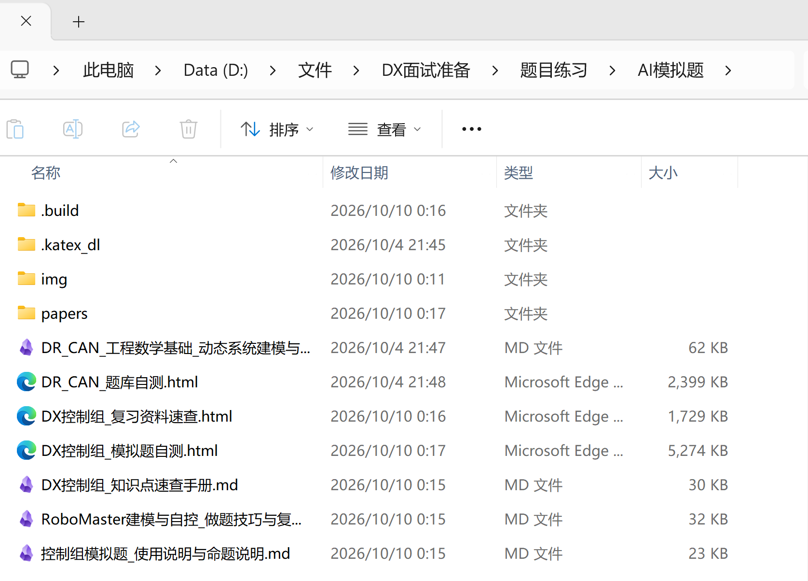

# 概念辨析
- **LLM**：
	- 大语言模型，具有大量参数
	- 根据输入字符串推理输出字符串的模型，推理本质是看输出字符串的概率分布，上下文是输入输出的字符串长度限制
- **agent**：
	- 能让LLM能够使用工具、与外部环境交互、并持续执行任务的软件
	- agent软件把工具能力弄成LLM可以阅读和返回的字符串，大模型输出相应字符串调用相应的工具。
	- 相同的模型在不同的agent发挥的性能不同
	- 类比理解：可被人操控的机甲，拥有各种功能。LLM为驾驶员，相同驾驶员在操控不同机甲发挥的能力不同。
- **skill**：
	- 专业知识与技能包，将工作流程与具体领域的知识打包
	- 是解决问题的知识与流程，指导LLM更好的调用工具
	- 可复用的任务指令和配套资源，模块化的专业知识
	- （类似其他人写好的提示词和工具的集合？）
- **AGENTS.md**：
	- 给AI看的项目说明书
	- 用于给AI 提供背景、开发规范和工作指引，规定验证标准
# 使用大模型帮助学习
1. 收集资料：（参考提示词：“去网上搜索关于xx的最佳实践/优秀参考，给出信息来源”）
2. 让ai帮我设计有针对性的课程与学习路线
3. 学习东西时，跟ai说自己的理解，ai纠错
4. AI练习题
# 使用大模型帮助开发
- **提示词框架**：
	1. 清楚说明目标
	2. 提供必要上下文
	3. 明确重要约束
	4. 规定验证标准
	5. 允许AI自主探索
	6. 避免过度规定执行步骤
- 使用skill和AGENTS.md 明确开发规范和约束
- 善用git等工具做好代码版本管理
- 负责任的使用ai，要理解ai写的代码
#  思考
- AI是一个工具，善于使用工具，对于新手的来说，任需要亲手训练理解，这样才能拥有判断对错的基础
- 我认为AI的能力是ai的不是我的，如何将ai的能力转化为我自己的能力是在使用的过程中需要重点思考的
- 在学习过程中使用AI能事半功倍，获取定制化的学习内容，更方便的资料查询
- **之前让ai出的控制原理的题目**：
- 使用ai的经历与反思：之前打电赛，完全使用ai备赛，但是并没有完全理解，导致后续调试的时候出现了许多问题，消耗更多的时间反而事倍功半，合理的使用ai而不是完全依赖它，这次学到教训了
- 最后我对ai的看法：不使用ai是不可能的，使用ai要对团队负责对自己负责。